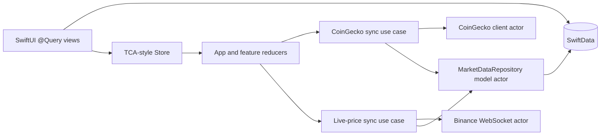
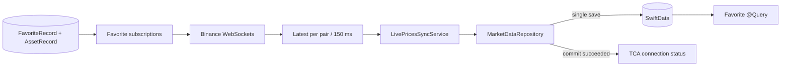

# Realtime Price Tracker architecture

## Invariant

SwiftData is the only source of market, favorite, and chart truth rendered by UI.
Network DTOs never enter view state. Reducer state contains only transient control
state such as loading, connection, retry, lifecycle, and effect cancellation.

The three persisted models are:

- `AssetRecord`: CoinGecko snapshot fields plus the latest committed Binance quote.
- `FavoriteRecord`: stable CoinGecko identity and selection time.
- `PricePointRecord`: cached CoinGecko chart samples.

Every screen uses `@Query`. This makes cached data available on cold launch before
network work starts and guarantees that UI changes are driven by database commits.

## Dependency direction

Provider clients expose Sendable domain DTOs. They do not know about SwiftUI,
SwiftData models, reducers, feature actions, or endpoint state. Sync use cases join
transport and persistence. Reducers receive success only after persistence succeeds.

## CoinGecko Top 100 flow

1. App activation starts the feature-owned ten-minute refresh loop.
2. `CoinGeckoClient` fetches the market-cap-ranked Top 100 using async `URLSession`.
3. `CoinGeckoSyncService` validates that the snapshot is non-empty.
4. `MarketDataRepository`, isolated with `@ModelActor`, upserts the whole snapshot
   and calls `save()` once.
5. Existing favorite rows are preserved even if they leave the Top 100. Old,
   non-favorite rows are deleted.
6. Only after commit does the reducer move to `loaded`.
7. `TopAssetsView` observes the committed rows with `@Query`.

If a request fails, existing records are untouched and remain visible. There is no
"network array" that can diverge from the offline cache.

## Favorite flow

Tapping a star sends only a CoinGecko ID. `AppReducer` runs a repository command,
which inserts or deletes `FavoriteRecord`, commits it, and then reads the resulting
favorite subscriptions. The Binance subscription is updated only after that commit.

Older `UserDefaults` favorites are imported once during app bootstrap. The legacy
key is cleared after a successful SwiftData transaction and is not used again as a
runtime source of truth.

## Binance live-price flow

Every WebSocket frame is decoded off the main actor. `LatestAssetBatcher` retains
the newest pending value per Binance pair and flushes approximately every 150 ms.
That is the write throttle: one batch becomes one SwiftData save. Batches are
processed in order; consistency takes priority over shaving write latency.

The repository maps Binance pair IDs back to stable CoinGecko IDs using the exact
subscription snapshot that opened the stream. If two favorites ambiguously map to
the same Binance pair, no live quote is written to either record; both remain on
their CoinGecko snapshot. Incorrect data is worse than missing realtime coverage.

Connection state becomes `live` only after a batch commits. A database failure
stops the stream and presents cached values as stale. Network failures use capped
0.5, 1, 2, 4, and 8 second reconnect delays.

## Chart flow

The details reducer requests a seven-day chart through `CoinGeckoSyncService`.
`MarketDataRepository` deletes the old samples, inserts the sorted replacement,
and saves once. `AssetDetailsView` queries the persisted points and continues to
show an older chart if refresh fails.

## Swift 6 concurrency ownership

- Reducers and the custom store are `MainActor` isolated and synchronous.
- HTTP, WebSocket clients, batching, and SwiftData writes have actor ownership.
- Cross-actor DTOs and actions conform to `Sendable`.
- Effects use `Task`, async/await, `AsyncStream`, task groups, cancellation handlers,
  and injected `Clock`; there is no Combine or callback-based concurrency.
- Background lifecycle actions cancel polling, watchdogs, reconnect delays, chart
  requests, and WebSocket consumers.

## Consistency rules

- A failed or empty CoinGecko response never replaces a valid cache.
- Snapshot replacement preserves favorite assets outside the current Top 100.
- Removing a favorite clears its old Binance quote.
- A Binance update is accepted only for a current, unambiguous favorite mapping.
- UI never renders provider DTOs or reducer-owned market arrays.
- Network success is reported only after the matching SwiftData transaction saves.

## Remaining production hardening

1. Replace symbol-derived Binance pairs with an explicit, validated provider-pair
   mapping (for example, Binance exchange metadata stored with each asset).
2. Add authenticated CoinGecko configuration plus `Retry-After`-aware backoff and
   jitter for production quota behavior.
3. Add an explicit image-byte cache if coin icons must be guaranteed offline; the
   asset metadata itself is already persisted.
4. Add a SwiftData migration plan before changing persisted model fields in a
   shipped version.
