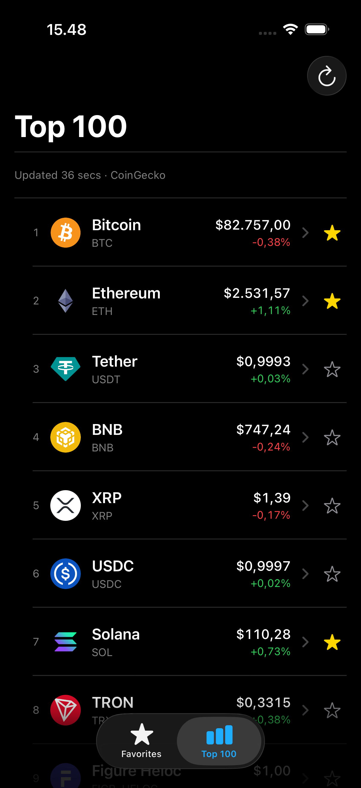
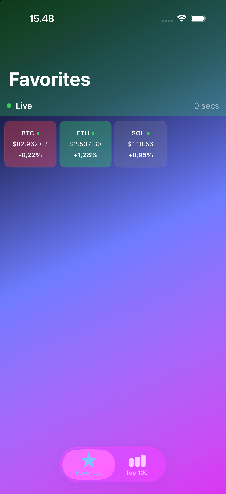

# Realtime Price Tracker

An offline-first iOS cryptocurrency market tracker built with Swift 6, SwiftUI,
and SwiftData. It shows CoinGecko's market-cap-ranked Top 100 and a persisted
Favorites collection. Binance WebSockets update favorite prices when a matching
market is available; cached market data remains visible without a connection.



---

## Features

- Browse a CoinGecko Top 100 snapshot saved to SwiftData.
- Keep favorites across launches and receive Binance live prices for supported pairs.
- View cached seven-day price charts in asset details using Swift Charts.
- See loading, stale, error, retry, and rate-limit states when requests fail.
- Continue viewing persisted assets, favorites, and chart points while offline.

### Favorites screenshot



---

## Technology

- **Language and UI:** Swift 6, SwiftUI, Observation, Swift Charts
- **Persistence:** SwiftData
- **Networking:** CoinGecko REST API through `URLSession`; Binance WebSockets
- **Concurrency:** Actors, async/await, task groups, cancellation, and injected clocks
- **State management:** Custom reducer and effect architecture inspired by TCA
- **Tests:** XCTest

---

## Architecture

SwiftData is the UI-facing source of truth. Provider responses are validated and
committed by sync services before reducers report success; SwiftUI screens observe
persisted assets, favorites, and chart points through `@Query`. Reducers hold
transient loading and connection state and own cancellable effects. Live Binance
updates are coalesced before a SwiftData batch write.

See [ARCHITECTURE.md](ARCHITECTURE.md) for the dependency map, data flows,
consistency rules, and remaining production hardening work.

---

## Build and run

- **Minimum deployment target:** iOS 26.2.
- **Toolchain verified in hosted CI:** Xcode 26.6 on `macos-26`, using an iPhone 17 Pro simulator with iOS 26.5.
- Open the project in a compatible Xcode installation, select the `RealTimePriceTracker` scheme, and run on a compatible simulator or device.

From the repository root:

```bash
open RealTimePriceTracker/RealTimePriceTracker.xcodeproj
```

The app uses the keyless CoinGecko API configuration by default. An API key is
not required for the sample setup.

---

## Data sources and update frequency

- CoinGecko supplies market-cap-ranked snapshots and seven-day chart data, which
  are committed atomically before UI observes them.
- The Top 100 refreshes every ten minutes while the app is active.
- Binance WebSockets supply realtime favorite prices. Latest values are coalesced
  for roughly 150 ms and each batch is saved to SwiftData in one transaction.
- CoinGecko snapshots remain visible when no matching Binance USDT pair is live.

The realtime pipeline provides:

- Offline rows available immediately on cold launch
- Latest-value persistence batches approximately every 150 ms
- Low-latency communication
- Per-symbol coalescing before UI updates
- Reactive UI synchronization

Actor-owned sockets, structured task groups, injected clocks, and cancellation
handlers keep transport work isolated and testable.

---

## Testing and CI

The shared `RealTimePriceTracker` scheme runs the unit-test target. **51 unit
tests passed in hosted GitHub Actions CI**, with 0 failed and 0 skipped in the
[verified run](https://github.com/KlinovK/realtime-price-tracker/actions/runs/41397149129).
UI tests are not yet implemented and are excluded from this scheme's Test action.
The CI workflow publishes test counts and retains an `.xcresult` artifact for
14 days. Passing CI verifies this build and test suite; it does not establish
all production behavior.

Run the shared scheme locally with an iPhone 17 Pro simulator running iOS 26.5:

```bash
xcodebuild test \
  -project RealTimePriceTracker/RealTimePriceTracker.xcodeproj \
  -scheme RealTimePriceTracker \
  -destination 'platform=iOS Simulator,name=iPhone 17 Pro,OS=26.5' \
  -derivedDataPath /private/tmp/rpt-stabilization-derived \
  -parallel-testing-enabled NO \
  -quiet \
  CODE_SIGNING_ALLOWED=NO
```

---

## Known limitations and next work

- Live subscriptions use an explicit CoinGecko ID to Binance pair registry for Bitcoin, Ethereum, and Solana. Other favorites stay snapshot-only. Current Spot availability and trading status are not yet checked; Binance exchangeInfo validation is planned for Stage 4.3.
- Production CoinGecko usage needs authenticated configuration and quota-aware backoff.
- Coin icon bytes are not cached for guaranteed offline display.
- Persisted model changes need a migration plan before shipping an update.
- UI automation and additional chart ranges are not yet implemented.

---

## Licensing

This project is licensed under the [MIT License](LICENSE).

---

## Author

Created by [KlinovK](https://github.com/KlinovK)

Repository: [Realtime Price Tracker](https://github.com/KlinovK/realtime-price-tracker)
