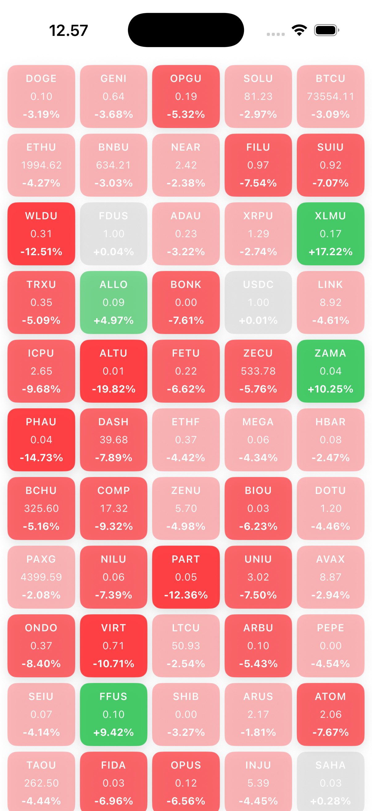

# Realtime Price Tracker

A modern real-time price tracking application built with **SwiftUI**, **WebSockets**, and **modern Swift concurrency**.

The project follows a **custom TCA-inspired architecture** for predictable state management and scalable feature development, while maintaining high performance and testability.



---

## Features

- 💾 Offline-first CoinGecko Top 100 backed by SwiftData
- ⭐ SwiftData favorite collection with persisted Binance realtime updates
- 📈 Offline-cached seven-day detail charts built with Swift Charts
- 🔄 Typed loading, stale, error, retry, and rate-limit states
- 🧠 Custom TCA-inspired architecture
- 🧵 Swift 6 strict concurrency, actors, clocks, and task groups
- 👁 SwiftData `@Query` UI observation with no Combine dependency
- 📱 Built entirely with SwiftUI

---

## Tech Stack

- **Language:** Swift 6
- **UI Framework:** SwiftUI, Swift Charts, Observation
- **Persistence:** SwiftData model actor with transactional batch writes
- **Architecture:** Custom TCA (The Composable Architecture inspired)
- **Networking:** Async URLSession and WebSockets
- **Concurrency:** Actors, async/await, structured task groups, injected clocks
- **Testing:** XCTest
- **Platform:** iOS

---

## Architecture Overview

The application uses a custom implementation inspired by **The Composable Architecture (TCA)** principles:

- SwiftData as the only UI-facing data source of truth
- Unidirectional data flow
- Reducer-based state updates
- Dependency injection
- Predictable side effects
- Testable business logic

This structure keeps state transitions synchronous while effects own asynchronous
HTTP, WebSocket, persistence, clock, and cancellation work. Reducers contain only
transient orchestration state; screens query persisted assets, favorites, and chart
points directly.

See [ARCHITECTURE.md](ARCHITECTURE.md) for the module map, end-to-end data flow,
connection state machine, Swift concurrency ownership, confirmed bottlenecks, and
the prioritized refactoring roadmap.

---

## Installation

Clone the repository:

```bash
git clone https://github.com/KlinovK/realtime-price-tracker.git
cd realtime-price-tracker
```

Open the project in Xcode:

```bash
open RealTimePriceTracker/RealTimePriceTracker.xcodeproj
```

Run the app on simulator or device.

---

## Requirements

- Xcode with the iOS 26.2 SDK
- iOS 26.2 (current project deployment target)
- Swift 6 language mode with complete strict-concurrency checking

---

## Data sources and update frequency

- CoinGecko supplies market-cap-ranked snapshots and seven-day chart data, which
  are committed atomically before UI observes them.
- The Top 100 refreshes every ten minutes while the app is active.
- Binance WebSockets supply realtime favorite prices. Latest values are coalesced
  for roughly 150 ms and each batch is saved to SwiftData in one transaction.
- CoinGecko snapshots remain visible when no matching Binance USDT pair is live.

The realtime pipeline provides:

- Offline rows available immediately on cold launch
- Latest-value persistence batches approximately every 150 ms
- Low-latency communication
- Per-symbol coalescing before UI updates
- Reactive UI synchronization

Actor-owned sockets, structured task groups, injected clocks, and cancellation
handlers keep transport work isolated and testable.

---

## Testing

The project includes comprehensive test coverage:

- ✅ Reducer tests
- ✅ State transition tests
- ✅ WebSocket service tests
- ✅ Async concurrency tests
- ✅ Integration tests

Run tests with:

```bash
⌘ + U
```

Or, from the repository root with an iPhone 17 Pro running iOS 26.5 available:

```bash
xcodebuild test \
  -project RealTimePriceTracker/RealTimePriceTracker.xcodeproj \
  -scheme RealTimePriceTracker \
  -destination 'platform=iOS Simulator,name=iPhone 17 Pro,OS=26.5' \
  -derivedDataPath /private/tmp/rpt-stabilization-derived \
  -parallel-testing-enabled NO \
  -quiet \
  CODE_SIGNING_ALLOWED=NO
```

---

## Future Improvements

- [ ] Explicit CoinGecko-to-exchange pair mapping
- [ ] Authenticated CoinGecko configuration and quota-aware backoff
- [ ] 24h, 30d, and 1y chart ranges
- [ ] Search and sorting for the Top 100
- [ ] SwiftData/CloudKit synchronization
- [ ] Push notifications
- [ ] Offline image byte cache
- [ ] Widget support
- [ ] macOS/iPadOS support

---

## Contributing

Contributions are welcome.

1. Fork the repository
2. Create a feature branch

```bash
git checkout -b feature/amazing-feature
```

3. Commit changes

```bash
git commit -m "Add amazing feature"
```

4. Push to branch

```bash
git push origin feature/amazing-feature
```

5. Open a Pull Request

---

## License

This project is licensed under the MIT License.

---

## Author

Created by [KlinovK](https://github.com/KlinovK)

Repository: [Realtime Price Tracker](https://github.com/KlinovK/realtime-price-tracker)
