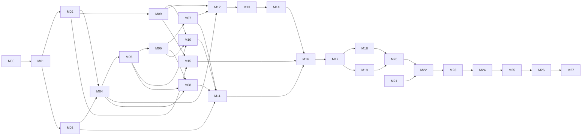

# CoinInsight roadmap

This document owns development order, milestones, gates, checkpoints and provisional values. [Product](product.md) owns behavior, [architecture](../ARCHITECTURE.md) technical contracts and [workflow](ai-workflow.md) process. Approval PLAN-8-R1.5 adopted the replacement context; ED-01-R1 later superseded its Git integration policy. Foundational documentation is established. M00–M27: 0/28 complete; spikes: 0/6; technical gates: 0/10 passed; quality gates: 0/5 passed; checkpoints: 0/5 complete. No target implementation or feasibility result is claimed.

## Development strategy (DS-01–03)

- **DS-01:** DS-01 Foundation-first: prove high-risk feasibility before dependent work; preserve the working app and valid behavioral tests; use small reviewable changes, not a Big Bang Rewrite.
- **DS-02:** DS-02 Hybrid delivery: establish just enough architecture for an end-to-end walking skeleton, then build working product increments. Grow DesignSystem only as actual screens need components.
- **DS-03:** DS-03 Dependency-driven gates: a feasibility spike shows that a technique can work; production verification shows the implemented feature works under its acceptance cases. Place each gate before its dependent work, while allowing unrelated work to continue.

Build foundation first, prove risky assumptions before dependent commitments, use a compiling walking skeleton and working feature increments, maintain quality continuously and avoid a big-bang rewrite. M00 establishes the essential local toolchain and risk-based integration workflow; QG-01 validates applicable integration evidence before dependent work, while separately authorized local M01 feasibility can proceed without a GitHub protection rule.

## Milestones M00–M27

Every row below is **NOT STARTED**. The approved source combines scope/deliverable/acceptance and dependency/evidence prose; both fields are retained here with named gate/checkpoint references. A stage is not passed by documentation.

### M00 — Repository Integration & Engineering Toolchain

- **Priority:** P0. **Status:** NOT STARTED.
- **Objective and scope:** Establish the ED-01-R1 risk-based integration workflow and reproducible essential tools. Excludes product code and speculative advanced gates. Deliver a workflow plan, pinned toolchain policy, lint/format/warning/coverage prototypes.
- **Deliverable and acceptance:** Deliver a reproducible essential toolchain and demonstrate the approved low-, medium- and high-risk integration paths with applicable verification and local/CI tool versions.
- **Dependencies and required evidence:** No product dependency. QG-01, QG-02 start, QG-05. Evidence: documented risk classification and authorized Git operations, representative PR/CI evidence where required, tool versions and reproducible local/CI results. GitHub protection configuration is optional.
- **Applicable gates:** QG-01, QG-02, QG-05. **Checkpoint/release relationship:** CP-01.

### M01 — Architecture Feasibility

- **Priority:** P0. **Status:** NOT STARTED.
- **Objective and scope:** Run bounded SP-01–06, record pass/fail and implications. Excludes production feature implementation. Deliver architecture feasibility record.
- **Deliverable and acceptance:** Record bounded SP-01–06 pass/fail evidence and implications; do not mistake prototypes for production acceptance.
- **Dependencies and required evidence:** M00 essential CI path; TG-01, TG-03/04 early, TG-05 early, TG-06 early. Evidence is compiling experiments, controlled store tests and documented provider contracts—not production acceptance.
- **Applicable gates:** TG-01, TG-03, TG-04, TG-05, TG-06. **Checkpoint/release relationship:** CP-01.

### M02 — TCA & SPM Foundation

- **Priority:** P0. **Status:** NOT STARTED.
- **Objective and scope:** Establish compiling local graph and one end-to-end walking skeleton through SwiftUI → TCA → application service → repository contract → SwiftData → Sendable domain data → TCA → SwiftUI. Preserve the working app during migration. Excludes full financial schema and wholesale feature rewrite.
- **Deliverable and acceptance:** Compile the walking skeleton; pass representative TestStore and repository integration tests plus green CI and early device smoke.
- **Dependencies and required evidence:** M01 TG-01 feasibility, SP-02; TG-02, QG-02, initial TG-10 device smoke; CP-01. Evidence: compile, representative TestStore, integration test and green CI.
- **Applicable gates:** TG-01, TG-02, QG-02, TG-10. **Checkpoint/release relationship:** CP-01.

### M03 — Financial Domain Foundation

- **Priority:** P0. **Status:** NOT STARTED.
- **Objective and scope:** Define validated Decimal values, pure calculator, portfolio snapshot domain model, and completeness/freshness contracts. Propose evidence-backed bounds from SP-04 for owner approval; production input constraints use only approved bounds. Excludes networking, SwiftData models and views.
- **Deliverable and acceptance:** Deliver pure validated Decimal/domain and snapshot contracts with deterministic edge/property arithmetic evidence.
- **Dependencies and required evidence:** M01 numeric findings; can overlap M02 after module contract agreed. Financial tests at approved coverage targets. Evidence: deterministic edge/property cases and documented arithmetic.
- **Applicable gates:** No gate named in this milestone; apply the gate register when affected. **Checkpoint/release relationship:** CP-04.

### M04 — Persistence Foundation

- **Priority:** P0. **Status:** NOT STARTED.
- **Objective and scope:** Target versioned schema, coherent reads, atomic holding/snapshot transaction, transition mechanism and recovery design. Verify with file-backed legacy fixtures, Decimal round trips and failure/rollback tests. Preserve needed legacy behavior; no final cutover or destructive retirement at M04.
- **Deliverable and acceptance:** Prove versioned schema, coherent reads, atomic holding/snapshot write, exact Decimal round trips and file-backed legacy recovery/rollback.
- **Dependencies and required evidence:** After M01 SP-03–05, M02 and M03. TG-03/04/05 and M04-stage TG-09 obligations. M04/M12 are not blocked on future M16/M17 final evidence.
- **Applicable gates:** TG-03, TG-04, TG-05, TG-09. **Checkpoint/release relationship:** CP-02/CP-04.

### M05 — Provider Adapters & Verified Asset Identity

- **Priority:** P0. **Status:** NOT STARTED.
- **Objective and scope:** CoinGecko ranking/metadata, Binance Spot pair metadata, USDT price/stats/history contracts, versioned explicit mapping. Excludes automatic fallback and credentials.
- **Deliverable and acceptance:** Deliver verified provider adapters and mapping; contract fixtures cover unsupported assets, failed verification and confirmed delisting.
- **Dependencies and required evidence:** M02 contracts; M01 provider feasibility. TG-06, QG-04 start. Fixture/controlled contract tests and coverage of unsupported, failed verification and confirmed delisting.
- **Applicable gates:** TG-06, QG-04. **Checkpoint/release relationship:** CP-02.

### M06 — Coordinated Synchronization

- **Priority:** P0. **Status:** NOT STARTED.
- **Objective and scope:** Shared single-flight, batching, rate limits/cooldowns, bounded retry, lifecycle-aware request ownership. Excludes UI-specific formatting.
- **Deliverable and acceptance:** Prove shared single-flight, bounded retry/cooldown, 429 handling and cancellation with deterministic multi-consumer traces.
- **Dependencies and required evidence:** M05 adapters, M04 commit boundary. TG-07 begins. Deterministic multi-consumer, 429 and cancellation evidence.
- **Applicable gates:** TG-07. **Checkpoint/release relationship:** CP-02.

### M07 — Live Market Data & Quote Freshness

- **Priority:** P0. **Status:** NOT STARTED.
- **Objective and scope:** Shared foreground Portfolio/visible-Details WebSocket demand, protected accepted quotes, per-pair fixed freshness and stale/historical presentation facts. Excludes Markets-wide stream.
- **Deliverable and acceptance:** Prove matching committed quotes, foreground demand, mapping/generation races, background suspension, reconnect and slow-consumer behavior.
- **Dependencies and required evidence:** M04–06, mapping eligibility. TG-07/08. Race, background, reconnect, slow-consumer and commit-before-live tests; CP-02 with M05/06.
- **Applicable gates:** TG-07, TG-08. **Checkpoint/release relationship:** CP-02.

### M08 — Historical Market Data

- **Priority:** P0. **Status:** NOT STARTED.
- **Objective and scope:** Persistent Binance USDT period-aware candle cache, incremental loading, obsolete-response protection and bounded display data. Excludes fabricated portfolio history.
- **Deliverable and acceptance:** Persist period-aware history; tests cover coverage gaps, deduplication, offline cache and obsolete responses.
- **Dependencies and required evidence:** M05/06 and M04 cache persistence. TG-06 relevant history contract. Coverage, gaps, dedup, offline and stale-cache tests.
- **Applicable gates:** TG-06. **Checkpoint/release relationship:** CP-03.

### M09 — Design System Foundation

- **Priority:** P0. **Status:** NOT STARTED.
- **Objective and scope:** Semantic colors, typography, states, accessible financial formatting and components needed by first screens. Excludes speculative library or financial logic.
- **Deliverable and acceptance:** Deliver needed semantic visual components; verify Light/Dark, Dynamic Type and accessible states.
- **Dependencies and required evidence:** M02 app/feature boundary; can overlap M03–08. QG-03 begins. Light/Dark, Dynamic Type and component evidence.
- **Applicable gates:** QG-03. **Checkpoint/release relationship:** CP-03/CP-04.

### M10 — Markets Feature

- **Priority:** P0. **Status:** NOT STARTED.
- **Objective and scope:** Supported ranked subset, search, sorting, refresh, USD market cap versus Binance USDT price/stats, cached/stale/error states.
- **Deliverable and acceptance:** Ship supported ranked Markets, search/sort and REST refresh; verify honest USD/USDT, offline, stale and error states.
- **Dependencies and required evidence:** M05/06, M09; M07 quote contract may be reused but no market-wide socket. CP-03 partly. UI and deterministic provider-state tests.
- **Applicable gates:** No gate named in this milestone; apply the gate register when affected. **Checkpoint/release relationship:** CP-03.

### M11 — Asset Details Feature

- **Priority:** P0. **Status:** NOT STARTED.
- **Objective and scope:** Shared details, USDT price, stats, interactive 1D/7D/1M/1Y chart, holding action.
- **Deliverable and acceptance:** Ship shared market Details, actual interactive ranges and holding-action contract; verify navigation, obsolete fetch and accessibility.
- **Dependencies and required evidence:** M07/08/09/10, M03 domain display contract. CP-03. Navigation, chart coverage, obsolete fetch and accessibility tests.
- **Applicable gates:** No gate named in this milestone; apply the gate register when affected. **Checkpoint/release relationship:** CP-03.

### M12 — Holding Management

- **Priority:** P0. **Status:** NOT STARTED.
- **Objective and scope:** Offline edit/delete, verified-online new crypto creation, offline USDT creation, one holding per asset; every successful holding mutation creates its corresponding snapshot atomically.
- **Deliverable and acceptance:** Ship one-holding CRUD; prove current-online crypto creation, offline edits/USDT creation, draft retention and atomic mutation snapshots.
- **Dependencies and required evidence:** M03 calculator/snapshot model, M04 atomic storage, M05 eligibility, M06 synchronized quotes, M07 accepted quote/freshness contract, M09 form components. Tests include save-failure draft retention, old-store data, offline edit, verified creation and mutation+snapshot atomicity.
- **Applicable gates:** No gate named in this milestone; apply the gate register when affected. **Checkpoint/release relationship:** CP-04.

### M13 — Portfolio Dashboard

- **Priority:** P0. **Status:** NOT STARTED.
- **Objective and scope:** Coherent current valuation, P&L, allocation, completeness/freshness, holding rows and sorting from one result. Excludes history-chart capture policy.
- **Deliverable and acceptance:** Ship coherent valuation, P&L and allocation; verify partial, delisted, native-USDT and calculator/UI consistency.
- **Dependencies and required evidence:** M12, M03/04, M07/09. CP-04 with M12. Financial examples, partial/delisted/USDT UI and calculator consistency.
- **Applicable gates:** No gate named in this milestone; apply the gate register when affected. **Checkpoint/release relationship:** CP-04.

### M14 — Portfolio History

- **Priority:** P0. **Status:** NOT STARTED.
- **Objective and scope:** Periodic/launch/foreground snapshot coordination, historical queries and 1D/7D/1M/1Y/ALL chart. Does not defer M12 mutation snapshots.
- **Deliverable and acceptance:** Ship actual portfolio history and lifecycle cadence; prove quality-aware snapshots, no fabricated backfill and device chart behavior.
- **Dependencies and required evidence:** M12 atomic path, M13 calculation, M04 snapshot store, M09 chart components. Quality-aware history tests and device chart evidence.
- **Applicable gates:** No gate named in this milestone; apply the gate register when affected. **Checkpoint/release relationship:** CP-05.

### M15 — Static AI Analysis

- **Priority:** P2. **Status:** NOT STARTED.
- **Objective and scope:** Independent offline Demo Mode report with illustrative data only. Excludes real holdings analysis, provider abstraction, network, LLM and chat.
- **Deliverable and acceptance:** Ship a plainly labeled static offline Demo Mode; verify no real input, provider/network/LLM dependency or artificial loading.
- **Dependencies and required evidence:** M02 feature shell, M09 visual primitives; can run parallel to M12–14. Feature test and comprehension/release-content review.
- **Applicable gates:** No gate named in this milestone; apply the gate register when affected. **Checkpoint/release relationship:** CP-05.

### M16 — Application Integration and Cutover Readiness

- **Priority:** P0. **Status:** NOT STARTED.
- **Objective and scope:** Integrate three tabs and M11↔M12 holding handoff; verify replacement flows and cutover readiness. Identify legacy records and recovery path. Actual legacy retirement needs separate explicit destructive-action authorization; never reset the new financial store automatically.
- **Deliverable and acceptance:** Integrate tabs and Details-to-editor handoff; prove cutover readiness and separately authorize any destructive retirement.
- **Dependencies and required evidence:** After migrated M05–M15 slices and their applicable gates. M16-stage TG-09 evidence, end-to-end integration and lifecycle checks; no unverified storage topology assumed.
- **Applicable gates:** TG-09. **Checkpoint/release relationship:** CP-05.

### M17 — Offline and Post-transition Recovery

- **Priority:** P0. **Status:** NOT STARTED.
- **Objective and scope:** Verify offline cache, holding management, persistent images/history, store initialization/migration failure and recovery after the chosen transition. Protect committed financial records; never automatically reset new financial storage.
- **Deliverable and acceptance:** Prove offline relaunch, cached icons/history, storage fault/retry recovery and protection of committed financial data.
- **Dependencies and required evidence:** After M16; M17-stage TG-09 recovery evidence, applicable device/UI and file-backed fault tests.
- **Applicable gates:** TG-09. **Checkpoint/release relationship:** CP-05.

### M18 — Performance & Reliability Stabilization

- **Priority:** P0. **Status:** NOT STARTED.
- **Objective and scope:** Profile and correct launch, UI, calculator, store, memory, energy, quote latency, chart workload; extended sessions.
- **Deliverable and acceptance:** Measure and correct realistic launch, render, store, memory, energy, streaming and chart reliability on devices.
- **Dependencies and required evidence:** Working integrated build M16/17; TG-10 production verification. Measured physical-device report, not candidate estimates.
- **Applicable gates:** TG-10. **Checkpoint/release relationship:** CP-05.

### M19 — Security, Privacy & Accessibility Verification

- **Priority:** P0. **Status:** NOT STARTED.
- **Objective and scope:** Threat model, file/backup protection, dependency/secret review, privacy manifests, basic accessible flows and English/locale checks.
- **Deliverable and acceptance:** Complete threat/privacy, file/backup, secret/dependency, accessibility and locale evidence with signed findings.
- **Dependencies and required evidence:** Implemented features M05–17. QG-03/04. Signed findings and device evidence.
- **Applicable gates:** QG-03, QG-04. **Checkpoint/release relationship:** CP-05.

### M20 — Feature Complete Verification

- **Priority:** P0. **Status:** NOT STARTED.
- **Objective and scope:** Confirm all approved V1 features, static AI, critical scenarios, docs-as-current status and no unresolved material defects. Feature Complete is not Release Ready.
- **Deliverable and acceptance:** Trace all approved V1 behavior to green integration evidence and documentation; leave no unresolved material defects.
- **Dependencies and required evidence:** M10–19 and applicable gates. CP-05. Traceable acceptance/test record and green integration CI.
- **Applicable gates:** No gate named in this milestone; apply the gate register when affected. **Checkpoint/release relationship:** CP-05.

### M21 — CoinInsight Branding / BRAND-01

- **Priority:** P3. **Status:** NOT STARTED.
- **Objective and scope:** Verify name/trademark availability, App Store identity; optionally rename GitHub repo, update display/project/docs/CI references, then verify. Excludes automatic bundle-ID or unnecessary internal-symbol rename.
- **Deliverable and acceptance:** Verify brand/name and mandatory App Store identity; keep optional repository rename separately authorized.
- **Dependencies and required evidence:** Can be prepared in parallel; mandatory App Store identity preparation before M22, optional repo rename does not block architecture/features. Separate authorization for actual rename.
- **Applicable gates:** No gate named in this milestone; apply the gate register when affected. **Checkpoint/release relationship:** M22 identity prerequisite.

### M22 — Release Candidate

- **Priority:** P0. **Status:** NOT STARTED.
- **Objective and scope:** Freeze candidate, satisfy release gates and branding identity, publish candidate evidence.
- **Deliverable and acceptance:** Freeze a release candidate with applicable gates, device/compliance evidence and human approval.
- **Dependencies and required evidence:** M20 and mandatory M21 identity portion; TG/QG release checks. Candidate build, device/security/privacy/accessibility and human approval.
- **Applicable gates:** No gate named in this milestone; apply the gate register when affected. **Checkpoint/release relationship:** release readiness.

### M23 — Internal TestFlight

- **Priority:** P0. **Status:** NOT STARTED.
- **Objective and scope:** Distribute approved candidate internally, record installation/feedback/crashes.
- **Deliverable and acceptance:** Distribute an authorized internal TestFlight build and record install, crash and feedback evidence.
- **Dependencies and required evidence:** M22; signed build and human authorization. TestFlight evidence.
- **Applicable gates:** No gate named in this milestone; apply the gate register when affected. **Checkpoint/release relationship:** release.

### M24 — External TestFlight

- **Priority:** P0. **Status:** NOT STARTED.
- **Objective and scope:** External beta and structured feedback; resolve material findings.
- **Deliverable and acceptance:** Complete authorized external beta, resolve material findings and revise candidate/retest when affected.
- **Dependencies and required evidence:** M23 and Apple external-test approval. Beta evidence, revised candidate as needed.
- **Applicable gates:** No gate named in this milestone; apply the gate register when affected. **Checkpoint/release relationship:** release.

### M25 — App Store Release

- **Priority:** P0. **Status:** NOT STARTED.
- **Objective and scope:** Submit compliant build and metadata, obtain human release authorization, monitor approval/rejection.
- **Deliverable and acceptance:** Submit only after applicable gates and human authorization; record App Store outcome.
- **Dependencies and required evidence:** M24, all blocking release gates, mandatory name/identity review. App Store submission and outcome evidence.
- **Applicable gates:** No gate named in this milestone; apply the gate register when affected. **Checkpoint/release relationship:** release.

### M26 — Post-release Monitoring

- **Priority:** P1. **Status:** NOT STARTED.
- **Objective and scope:** Privacy-safe native crash/performance/provider/review monitoring and response. Excludes unapproved remote telemetry.
- **Deliverable and acceptance:** Record privacy-safe post-release crash, performance, provider and user feedback monitoring.
- **Dependencies and required evidence:** M25. Incident, metric and user-feedback record.
- **Applicable gates:** No gate named in this milestone; apply the gate register when affected. **Checkpoint/release relationship:** post-release.

### M27 — Maintenance & Product Improvements

- **Priority:** risk-based. **Status:** NOT STARTED.
- **Objective and scope:** Prioritize verified defects, dependency/provider changes and separately approved enhancements. Excludes automatic expansion to trading, backend or real AI.
- **Deliverable and acceptance:** Prioritize separately approved fixes/enhancements with scoped regression and release evidence.
- **Dependencies and required evidence:** M26 evidence and new scoped approval. Regression/release evidence.
- **Applicable gates:** No gate named in this milestone; apply the gate register when affected. **Checkpoint/release relationship:** new scoped acceptance.

## Dependency and transition model

The critical financial path is M03 → M04 → M12 → M13 → M14. M11 market Details and M12 holding CRUD converge at M16; CP-03 does not certify CRUD. M04 delivers target schema/transition mechanism and file-backed proof; M05–M15 migrate incrementally; M16 proves cutover readiness and seeks separate authorization for any destructive legacy retirement; M17 proves recovery. TG-09 is one staged gate. M04 and M12 can meet their stage obligations before final M16/M17 evidence, without marking TG-09 finally passed. QG-01 validates risk-based integration, not isolated authorized feasibility.

## Technical spikes SP-01–06

All are **PLANNED and unexecuted**. A failed hypothesis blocks dependent production assumptions and requires a scoped decision, not an automatic fallback.

### SP-01 — TCA compatibility

- **Hypothesis and scope:** One pinned released TCA version builds with the project’s Xcode/iOS/Swift settings; one representative reducer/TestStore test works.
- **Measurable acceptance and required evidence:** Clean resolution, compile log, version and test result. Before M02/TG-01.
- **Dependent decision:** TCA version and M02/TG-01. **Status:** PLANNED; no result. **Failure handling:** mark blocked, preserve the approved scope and return the failed assumption for explicit review.

### SP-02 — SPM graph

- **Hypothesis and scope:** Proposed balanced targets compile without circular imports and maintain Domain independence.
- **Measurable acceptance and required evidence:** Minimal package targets and import check. Before M02/TG-02.
- **Dependent decision:** module graph and M02/TG-02. **Status:** PLANNED; no result. **Failure handling:** mark blocked, preserve the approved scope and return the failed assumption for explicit review.

### SP-03 — atomic transaction

- **Hypothesis and scope:** One holding mutation and its snapshot commit together or neither commits under controlled failure.
- **Measurable acceptance and required evidence:** File-backed prototype with save/rollback/relaunch evidence. Early M01, production proof M04/TG-03.
- **Dependent decision:** atomic financial write and M04/TG-03. **Status:** PLANNED; no result. **Failure handling:** mark blocked, preserve the approved scope and return the failed assumption for explicit review.

### SP-04 — Decimal persistence

- **Hypothesis and scope:** Candidate-range Decimal values and precision assumptions round-trip exactly through selected storage representation; this early feasibility spike does not approve production bounds.
- **Measurable acceptance and required evidence:** Boundary-value test and relaunch evidence. Numeric bounds need explicit approval. Early M01, production proof M04/TG-04.
- **Dependent decision:** Decimal contract and M03/M04/TG-04. **Status:** PLANNED; no result. **Failure handling:** mark blocked, preserve the approved scope and return the failed assumption for explicit review.

### SP-05 — actor isolation

- **Hypothesis and scope:** Controlled concurrent quote/holding reads and writes yield coherent financial input and reject obsolete publications.
- **Measurable acceptance and required evidence:** Deterministic suspension/revision tests. Early M01, production proof M04/TG-05.
- **Dependent decision:** actor isolation and M04/TG-05. **Status:** PLANNED; no result. **Failure handling:** mark blocked, preserve the approved scope and return the failed assumption for explicit review.

### SP-06 — provider access

- **Hypothesis and scope:** Keyless/approved provider contracts, rate limits, terms and territory behavior can support the V1 scope.
- **Measurable acceptance and required evidence:** Official contract record and controlled, noncredentialed evidence where authorized. Before M05/TG-06.
- **Dependent decision:** provider access and M05/TG-06/QG-04. **Status:** PLANNED; no result. **Failure handling:** mark blocked, preserve the approved scope and return the failed assumption for explicit review.

## Technical gates TG-01–10

All are **OPEN**. Prototype feasibility and production proof are separate where stated; a spike alone does not pass a production gate.

| Gate | Scope and acceptance | Dependency/evidence | Status |
| --- | --- | --- | --- |
| TG-01 TCA compatibility; unsupported release/toolchain. SP-01. | Representative compile/test → pinned version, full affected target build and reducer tests in CI; logs/version lock. | M02/CP-01 onward; reopen on Xcode/TCA upgrade or compile regression. | OPEN |
| TG-02 SPM graph; cycles/leaky Domain. SP-02, TG-01. | Minimal graph compile → all target modules compile with import-boundary checks and resources/tests; graph/build report. | M02/CP-01, all modules; reopen on dependency change. | OPEN |
| TG-03 atomicity; holding without matching snapshot. SP-03, M03 rules. | Controlled prototype → production file-backed save/failure/cancel/relaunch cases prove both-or-neither; transaction artifact. | M04/M12/CP-04; reopen on schema/write-path change or split record. | OPEN |
| TG-04 Decimal round trip; precision loss. SP-04 and approved numeric bounds. | Boundary prototype → production migration/round-trip tests across allowed values; exact comparison report. | M04/M12/financial display; reopen on representation/bounds change. | OPEN |
| TG-05 coherent persistence; mixed-version calculation. SP-05, M04 design. | Controlled actor race → production concurrent read/write, revision and obsolete-publication tests; deterministic traces. | M04/M12/M13; reopen on context/actor/query change. | OPEN |
| TG-06 provider contracts; wrong fields, quotas or inaccessible service. SP-06, M05 adapters. | Primary docs and controlled fixtures → contract tests, approved access/territory, rate/cooldown and integration evidence; provider matrix. | M05–11/CP-02; reopen on provider API/terms change. | OPEN |
| TG-07 REST/WS races; obsolete quote accepted. M06/07 revision model. | Deterministic simulated race → production acceptance tests for request revision, stream generation, mapping change, invalid batch and save failure; trace. | M07/M12/CP-02; reopen on sync/quote logic change. | OPEN |
| TG-08 WS lifecycle; leak/background streaming. M07 coordinator. | Controlled fake stream → production foreground/background, visibility union, cancellation, reconnect, slow-consumer tests; device logs when appropriate. | M07/M11/M16; reopen on navigation/subscription change. | OPEN |
| TG-09 — Single staged legacy transition gate | M04: file-backed transition-mechanism and rollback/recovery fixtures. M16: cutover readiness and authorized retirement evidence if retirement occurs. M17: post-transition recovery. Final PASSED requires all applicable obligations; earlier stage acceptance can unblock M04/M12 without final PASSED. | Reopen on schema/transition changes. No network or destructive reset inside transaction; storage topology remains feasibility-dependent. | OPEN |
| TG-10 device profiling; simulator-only confidence. M02 runnable slice, later integrated app. | Early device smoke → measured launch/render/store/network/energy/reliability against approved budgets; device report. | M02 smoke, M18 and release; reopen on device/OS or material workload change. | OPEN |

TG-09 has M04 mechanism fixtures, M16 cutover/authorized-retirement evidence if retirement occurs, and M17 recovery. Final PASSED requires all applicable stages. Reopen affected evidence after schema or transition changes.

## Quality gates QG-01–05

All are **OPEN** and activate with their named milestones. ED-01-R1 makes GitHub protection optional; QG-01 remains open until the risk-based workflow has applicable verification.

| Gate | Activation and verification | Reopen condition | Status |
| --- | --- | --- | --- |
| QG-01 Risk-Based Integration, M00 | Verify ED-01-R1 on representative work: low-risk direct integration only after applicable checks; medium-risk branch/PR when justified; high-risk independent review, PR and successful applicable CI before merge. Check authorization scope, user-change preservation, no force push/history rewrite/check bypass, and post-merge verification. GitHub protection is optional; repository administration still needs explicit authorization. | Missing applicable test or CI evidence, skipped high-risk review, unauthorized operation, user-change loss, failed-check bypass or workflow drift. | OPEN |
| QG-02 Coverage Pipeline, M00–02 | Generate reproducible per-module/overall project-owned coverage, reviewed exclusions and progressive approved thresholds with regression check. Evidence: report and deliberately failing threshold test. | Broken extraction, misleading exclusions, threshold not enforced, toolchain change. | OPEN |
| QG-03 Accessibility & Localization, M09–20 | Basic Accessibility and English-first String Catalog/locale checks enter with features; manual device/assistive-tech report and UI/resource tests close gate. | Missing essential chart alternative, clipped critical value, unlabeled state, resource/locale regression. | OPEN |
| QG-04 Privacy & Release Compliance, M05–22 | Threat model, provider terms, file/backup protection, secret/dependency review, privacy manifest/disclosure and static AI Demo Mode suitability record. | Provider terms, data flow, dependency, release territory or App Review requirement changes. | OPEN |
| QG-05 Engineering Toolchain, M00 | Pin and verify essential SwiftLint/SwiftFormat, warnings-as-errors policy, static analysis and architecture checks; classify coverage/sanitizer/mutation feasibility separately so unverified advanced checks do not block unrelated architecture work. | Tool/version drift, false blocking, missing reviewed exception or irreproducible CI. | OPEN |

## Product checkpoints CP-01–05

All are **NOT COMPLETE**. A material change invalidates only affected checkpoint evidence; reverify it before relying on that checkpoint. Do not invent a separate REOPENED checkpoint status.

| Checkpoint | Scope | Evidence | Status |
| --- | --- | --- | --- |
| CP-01 Architecture Ready | M00–02; TG-01/02; QG-01/05 and usable QG-02 path. | Compiling walking skeleton, representative TCA/repository integration tests, green CI; early device smoke. It does not certify full persistence or product feature correctness. | NOT COMPLETE |
| CP-02 Market Data Ready | M04–07; TG-06/07/08, relevant TG-05; QG-04 provider/privacy portion. | Verified mapping, eligibility, deterministic quote acceptance, rate-aware sync, foreground/background live lifecycle. | NOT COMPLETE |
| CP-03 Markets Ready | M08–11 and CP-02; chart/provider gates and QG-03 feature checks. | End-to-end Markets and shared Details, including offline, unsupported, stale, USD/USDT and chart cases. | NOT COMPLETE |
| CP-04 Portfolio Ready | M03/04, M12/13 and CP-02; TG-03/04/05/09 plus relevant quality gates. | Holdings CRUD, atomic snapshots, coherent total/P&L/allocation, USDT, delisted and offline cases. M14 history chart is later, but mutation snapshots already exist. | NOT COMPLETE |
| CP-05 Feature Complete | M14–20 plus CP-03/04 and M15; applicable TG/QG results. | All approved V1 features integrated, critical tests, UI/device and documentation-status evidence. Not Release Ready. | NOT COMPLETE |

## Approved roadmap corrections

| ID | Effective correction |
| --- | --- |
| F-01 | M00 separates local essential tooling from risk-based integration; QG-01 verifies applicable Git/CI workflow evidence without requiring GitHub protection before separately authorized local M01 work. ED-01-R1 supersedes the earlier protected-integration prerequisite. |
| F-02 / FR-01 | M04 mechanism, M05–M15 migration, M16 cutover/authorized retirement, M17 recovery; one staged TG-09; no future-stage dependency cycle. |
| F-03 | Trace decisions to owning milestone/evidence; preserve source gaps. |
| F-04 | SP-06 checks technical, commercial, territorial, redistribution and operational provider feasibility; failure reopens access decision. |
| F-05 | M09 image presentation, M10 persistent bytes, M17 offline proof, M18 profiling. |
| F-06 | M11 market Details and M12 CRUD meet at M16; CP-03 excludes CRUD. |
| F-07 | SP-04 tests candidates; M03 proposes Decimal bounds; owner approves before M04 production constraints. |
| F-08 | New non-USDT holding needs current online verification before atomic write, no network within transaction. |
| F-09 | Material beta findings can require scoped fixes, applicable gate re-verification and revised release candidate. |
| F-10 | Non-USDT acquisition price is optional USDT; native USDT has no cost input or P&L. |
| FR-02 | Material changes invalidate applicable checkpoint evidence until reverified; no new checkpoint status. |
| FR-03 | BRAND-01 stays P3; App Store identity before M22; optional repo rename separately authorized and not a prerequisite. |

## Provisional parameters

All 17 groups below are **candidate inputs only**. They are not production limits or passed gates. Each needs controlled measurement/contract evidence and separate approval before constraining product behavior.

| Group | Candidate value/range | Purpose | Validation and owner | Approval |
| --- | --- | --- | --- | --- |
| Decimal | minimum quantity 1e-18; maximum quantity 1e15; maximum acquisition price 1e12; up to 18 fractional digits; banker's rounding candidate | Design/test hypothesis for decimal | SP-04/M03/M04 exact-value and persistence boundary tests | Unapproved; owner decision after evidence |
| Market data | ranking refresh 10 minutes; metadata TTL 15 minutes; REST quotes 30 seconds; statistics 60 seconds; freshness 60 seconds; 3 retries at 1/2/4 seconds | Design/test hypothesis for market data | SP-06/M05/M06 provider contract, quota and freshness evidence | Unapproved; owner decision after evidence |
| WebSocket | approximately 150 ms batch; 25 streams per socket; reconnect delays 0.5/1/2/4/8/15/30 seconds | Design/test hypothesis for websocket | M07/TG-08 lifecycle and latency measurements | Unapproved; owner decision after evidence |
| Portfolio snapshots | foreground cadence 15 minutes; deduplication window 5 minutes | Design/test hypothesis for portfolio snapshots | M12/M14 file-backed cadence/dedup evidence | Unapproved; owner decision after evidence |
| Historical intervals | 1D 5 minutes; 7D 1 hour; 1M 4 hours; 1Y 1 day; completed candle closes candidate | Design/test hypothesis for historical intervals | M08 provider coverage/gap tests | Unapproved; owner decision after evidence |
| Historical retention | 2/14/60/400 days by corresponding period | Design/test hypothesis for historical retention | M08/M17 storage and offline tests | Unapproved; owner decision after evidence |
| Image cache | disk 50 MB; memory 10 MB | Design/test hypothesis for image cache | M10/M17/M18 disk/memory/offline profiling | Unapproved; owner decision after evidence |
| Charts | 300–600 displayed points | Design/test hypothesis for charts | M08/M11 device rendering/profile evidence | Unapproved; owner decision after evidence |
| Presentation performance | cold launch P95 <=1.5 seconds; warm launch <=500 ms; cached portfolio <=1 second; tab <=100 ms; Details <=200 ms; chart <=300 ms | Design/test hypothesis for presentation performance | M18/TG-10 device distributions | Unapproved; owner decision after evidence |
| Calculator | 10 holdings <=2 ms; 50 <=5 ms; 100 <=10 ms | Design/test hypothesis for calculator | M03/M18 exact-value and measured workloads | Unapproved; owner decision after evidence |
| Storage performance | snapshot prep <=20 ms; coherent read <=50 ms; holding+snapshot commit <=100 ms; quote batch <=100 ms; chart read <=100 ms; history query <=200 ms | Design/test hypothesis for storage performance | M04/M18 file-backed and device measurements | Unapproved; owner decision after evidence |
| Memory | typical 150 MB; chart 200 MB; peak 250 MB | Design/test hypothesis for memory | M18 device sessions | Unapproved; owner decision after evidence |
| WebSocket latency | receive-to-commit <=400 ms; commit-to-valuation <=100 ms; receive-to-visible <=600 ms | Design/test hypothesis for websocket latency | M07/M18 measured receive/commit/display traces | Unapproved; owner decision after evidence |
| Stress scenarios | 100 holdings; 100,000 observations; 200,000 portfolio snapshots; these are test workloads, not product limits | Design/test hypothesis for stress scenarios | M18 reliability workloads; test cases, not product limits | Unapproved; owner decision after evidence |
| Reliability | 4 hours foreground; 1 hour background; 30 minutes unstable connectivity; 50 lifecycle transitions | Design/test hypothesis for reliability | M18 bounded device sessions | Unapproved; owner decision after evidence |
| TestFlight | 5–15 testers; 7–14 days | Design/test hypothesis for testflight | M23/M24 beta plan and feedback | Unapproved; owner decision after evidence |
| Mutation testing | score >=90% candidate | Design/test hypothesis for mutation testing | QG-02 feasibility and quality review | Unapproved; owner decision after evidence |

## Branding and release

M21/BRAND-01 P3 verifies name/trademark and mandatory App Store identity before M22. Optional repository rename is separately authorized and does not block release readiness. Human authorization is required for TestFlight, App Store submission and release. Product name availability and App Store suitability of static Demo Mode remain open.
